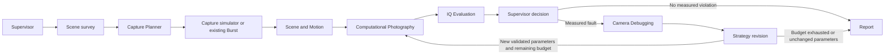

# P4 至 P6 场景分析、IQ 与 Agent 闭环

## 运行

```powershell
python scripts/run_agent_workflow.py --goal "处理夜景 RAW，降低噪声并减少行人鬼影"
python scripts/run_agent_workflow.py --goal "HDR 恢复高光" --burst <BURST_ID>
python scripts/run_agent_workflow.py --goal "降低运动模糊" --raw-manifest sequence.yaml
python scripts/run_agent_feedback_demo.py
```

省略输入时使用默认合成配置作为场景和传感器模板。`--simulation` 可指定另一份模板。模拟曝光与增益由 Capture Planner 的计划决定，本地序列沿用已有曝光元数据。`--pipeline-parameters` 可给首轮提供 P3 YAML 参数，模式与参考帧仍由计划决定。使用规则式 Mock 模式解析中英文拍摄目标并选择算法。采集、配准和所有指标由本地 Python 工具计算。

## 状态流



捕获计划包含模式、帧数、曝光时间、模拟增益、选帧、参考帧、融合策略、约束和理由。`CapturePlan.model_validate(report["capture_plan"])` 可直接重读报告计划。`simulate_capture` 实际应用曝光与增益，摄影 Agent 验证计划与已采集帧一致后调用 Night、HDR 或 Motion-aware Pipeline。

Scene & Motion 使用亮度直方图、高光和暗部比例、Laplacian 方差、曝光归一化亮度差、ECC 和 Farneback。工具操作图像数组，LangGraph 状态只存产物 ID、参数和数值证据。[LangGraph Python Graph API](https://docs.langchain.com/oss/python/langgraph/graph-api)

## IQ 与修复

| 测量 | 条件或验证方法 |
| --- | --- |
| PSNR、SSIM、细节保留 | 比较与参考曝光中点匹配的合成 Ground Truth。缺少校准参考时返回 `null` 和原因 |
| Noise STD | 平滑区高通残差的 MAD 估计，受纹理和插值影响 |
| Alignment Error | 有效重叠、未饱和区域的亮度引导图光度残差。严重曝光差也可能影响该指标 |
| Ghosting Score | 独立检测可比较帧中的连贯运动区域，量化最终图与参考帧的偏差。运动区域支持不足时返回 `null` |
| Clipping、Runtime | 输出白值比例、无有效曝光的参考裁剪通道比例和摄影工具实测耗时 |
| MTF50 | 当前输入缺少合格斜边靶标，返回 `null` |

Supervisor 按门限判定配准或鬼影风险。Debugging 调 `validate_diagnosis` 从落盘产物重算证据，存储可检验假设、输入产物、实测值、门限、验证结果、置信度依据和建议参数。配准修复启用相位相关初始化与 ECC，鬼影修复启用参考帧保护并收紧运动阈值。置信度是由证据超限比例计算的规则分数。重处理写入新产物，IQ 重新计算，并在报告中并排记录修复前后指标。

默认最多两次修订、三轮摄影实验、每个工具 45 秒、瞬时失败最多重试一次。工具注册表验证参数和输出，白名单工具由独立子进程执行，超时时终止进程并记录尝试。预算耗尽后仍验证测得的故障，报告标记为 `needs_review`。最终输出选择按已测故障数、超限强度和可用的 PSNR 排序。无参考诊断可能受前景运动、低纹理及曝光差影响。

## 验收案例

`run_agent_feedback_demo.py` 使用显式首轮开关构造两个可控故障，并保留两轮输出用于核验。

| 案例 | 首轮设置与验证 | 下一轮实际变化 | 修复前后 |
| --- | --- | --- | --- |
| 已知平移 RAW 序列 | 首轮关闭配准，工具测得残差越界 | 启用相位相关初始化与 ECC，恢复约 `(12, -8)` 像素 | 配准残差 `0.03871 → 0.00046` |
| 运动行人合成 Burst | 首轮关闭去鬼影，工具测得运动区域融合污染 | 启用去鬼影与参考帧保护并收紧阈值 | 鬼影代理分数 `0.03831 → 0.00000`，Ground Truth PSNR `28.30 → 29.73 dB` |

闭环诊断当前覆盖配准与鬼影。其余 IQ 指标用于观测。运行记录保存在 `artifacts/reports/<report_id>/metadata.json`，每轮图像及中间阵列依照 `attempts[].artifact_id` 位于 `artifacts/photography/`。源 RAW 文件以只读方式打开。
